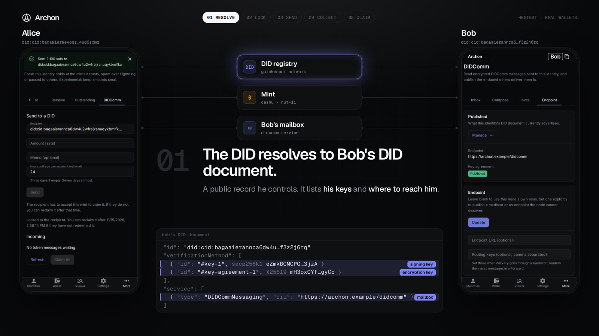
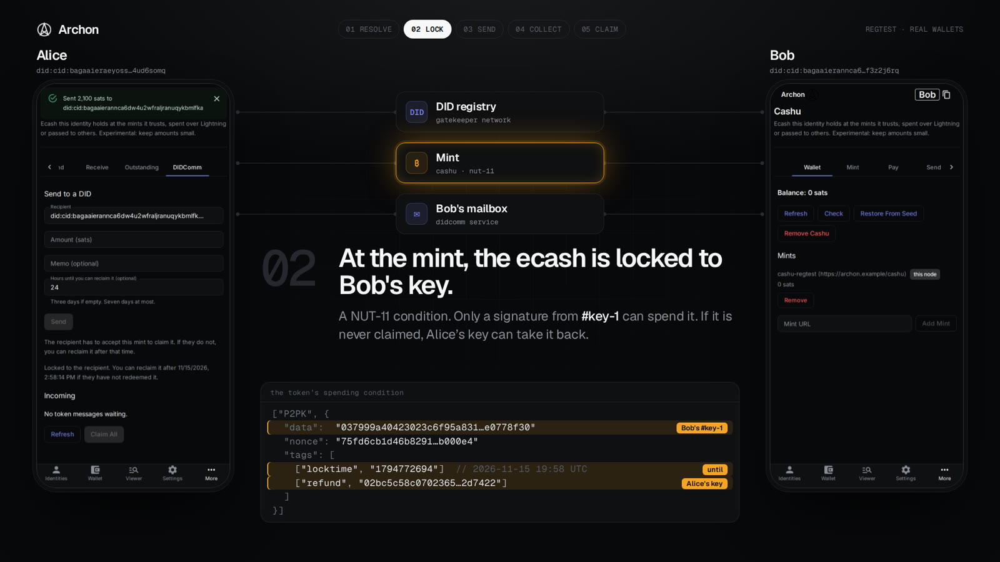
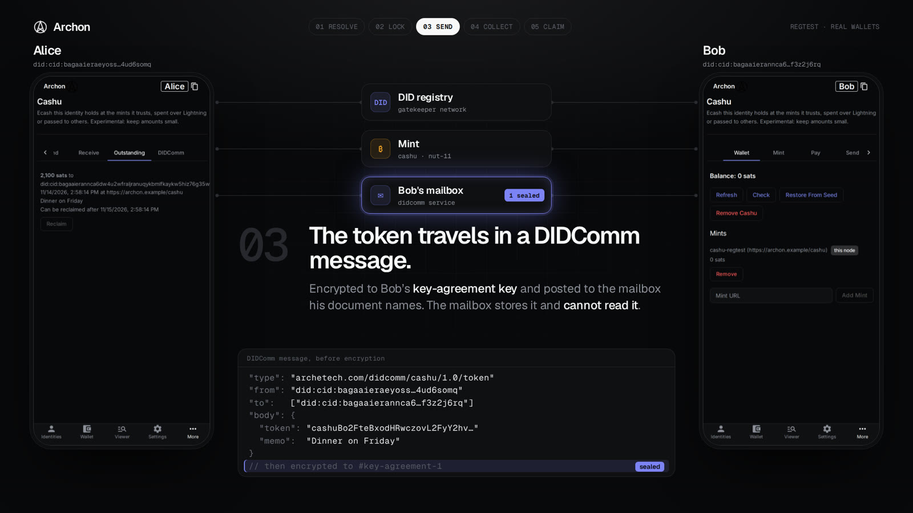

# Archon at Nut November 2026

**Ecash you can send to an identity, and ecash an AI agent can spend by itself.**

https://github.com/user-attachments/assets/559e5a98-7f54-427f-a4b0-4e19b4f16d4d

*One payment from Alice to Bob, recorded from two real wallets (70 seconds, with sound).*

[Archon](https://github.com/archetech/archon) is an open-source (MIT) decentralized
identity system: people and software agents hold DIDs, and a wallet called Keymaster
holds their keys. In November we gave every Archon identity a Cashu wallet, and then
used the identity to do three things with ecash that a Cashu wallet alone cannot.

1. **Send ecash to a DID.** The wallet locks the token to the recipient's key
   (NUT-11) and delivers it over DIDComm to the mailbox the recipient's DID document
   names. A token that leaks on the way is worth nothing, and the sender can reclaim
   one that is never claimed.
2. **Pay an HTTP 402 with ecash (NUT-24), on both sides.** Archon nodes now accept
   ecash for priced API calls, and Archon wallets pay such requests. An AI agent
   with its own DID pays per call from its own ecash, and refuses a price above the
   limit its owner set.
   The [NUT index](https://github.com/cashubtc/nuts) lists no implementation of
   NUT-24 as of November 14.
3. **Two Cashu wallets that agree.** Archon's wallet software comes in a TypeScript
   version and a Python version, and each now has the full Cashu wallet. The
   TypeScript one is built on cashu-ts. The Python one is written from scratch,
   including the blind-signature cryptography and the token formats. Both pass the
   same test vectors, and in our tests each sends ecash to the other.

Along the way we reported a bug in cdk's CLN backend, with a fix, both found by
testing against real Lightning.

## What is new since November 1

All of it. Archon had no Cashu code before November 3; the first commit is
[#1504](https://github.com/archetech/archon/pull/1504), the plan. The idea was written
down earlier as issue [#1058](https://github.com/archetech/archon/issues/1058), opened
September 6, and nothing was built from it until this month. What existed before is
Archon itself: DIDs, Keymaster, DIDComm messaging, the Drawbridge API gateway and
its Lightning (L402) paywall.

| Date | What landed | PR |
|---|---|---|
| Nov 4 | A Cashu mint (cdk-mintd) as an optional part of an Archon node, served through the node's gateway | [#1517](https://github.com/archetech/archon/pull/1517) |
| Nov 5 | The wallet in TypeScript and Python, with a REST API | [#1520](https://github.com/archetech/archon/pull/1520) |
| Nov 5 | The wallet in both SDKs, three CLIs and the MCP server, so agents can use it as tools | [#1525](https://github.com/archetech/archon/pull/1525) |
| Nov 5 | **Ecash locked to a DID and sent over DIDComm**, with a published message spec | [#1526](https://github.com/archetech/archon/pull/1526) |
| Nov 6 | A test suite on regtest Lightning: four CLN nodes, real invoices, routes, fees and failures | [#1529](https://github.com/archetech/archon/pull/1529) |
| Nov 6 | The Cashu screens in the React wallet, the browser extension and the demo clients | [#1531](https://github.com/archetech/archon/pull/1531) |
| Nov 6 | An animated walkthrough of the whole design | [#1536](https://github.com/archetech/archon/pull/1536) |
| Nov 11 | **Nodes accept ecash as HTTP 402 payment** (NUT-24, NUT-18) | [#1598](https://github.com/archetech/archon/pull/1598) |
| Nov 11 | **Wallets decode and pay a Cashu payment request** (NUT-18, NUT-26), within a stated maximum | [#1605](https://github.com/archetech/archon/pull/1605), [#1606](https://github.com/archetech/archon/pull/1606) |
| Nov 11 | An agent pays a node's paywall with ecash, end to end on regtest | [#1607](https://github.com/archetech/archon/pull/1607) |
| Nov 13 | Animated QR codes for long tokens (NUT-16): shown everywhere, scanned on Android | [#1617](https://github.com/archetech/archon/pull/1617) |
| Nov 14 | A video of one payment, recorded from real wallets | [#1622](https://github.com/archetech/archon/pull/1622) |

That is about 7,000 lines of wallet, gateway and interface code, not counting tests.

## Sending ecash to a DID

A Cashu token is cash: whoever holds the string can spend it. Sending one safely
means trusting the channel it travels over. Archon removes that trust by using what
a DID already publishes.

Alice pastes Bob's DID and an amount. Her wallet does the rest:

1. **Resolve.** The DID resolves to Bob's DID document, a public record he controls.
   It lists his signing key, his encryption key and the address of his DIDComm
   mailbox.

   

2. **Lock.** At the mint, Alice's ecash is swapped for ecash that only a signature
   from Bob's signing key can spend. Her own key is written in as the refund key,
   valid after a time she chooses.

   

3. **Send.** The token goes in a DIDComm message, encrypted to Bob's encryption key
   and posted to his mailbox. The mailbox stores it and cannot read it.

   

4. **Collect.** Bob's wallet proves it controls his DID, fetches the message and
   decrypts it.
5. **Claim.** Bob's wallet signs with the key the ecash is locked to, and the mint
   issues him ecash of his own.

Those pictures are frames of the video at the top. Its screens are screenshots of two
wallets making this payment, and the panels quote that payment's own DID document,
spending condition and message. The source, with the script that records it, is in
[`docs/promo/ecash-did`](promo/ecash-did).

The message format is published as a DIDComm protocol,
[`https://archetech.com/didcomm/cashu/1.0`](https://archetech.com/didcomm/cashu/1.0),
so another wallet can send a token to an Archon identity or receive one from it.

## Paying an HTTP 402 with ecash

An Archon node can charge for API calls. Until this month the only way to pay was
L402, which needs a Lightning payment for each credential. Now a priced call answers
`402` with both: a Lightning invoice, and an `X-Cashu` header holding a NUT-18
payment request. A client retries with a token in the same header.

- **The node** checks the token's mint, unit and amount, and redeems it at the mint
  before serving, so a token cannot be spent twice. The ecash goes into the node's
  own Cashu wallet.
- **The wallet** has two commands for the client side. `cashu-decode-request` says
  what a request asks for; `cashu-pay-request --max <sats>` pays it and refuses a
  request for more than the maximum. The maximum is on the amount requested; the
  mint's fee, if it charges one, is on top. Both read `creqA` and the bech32m
  `creqB` form.
- **An agent** uses the same two calls through the SDK or as MCP tools.
  [`agent.mjs`](../tests/cashu-regtest/agent.mjs) is a complete example in under 80 lines:
  it registers a new DID through a paywalled node, gets the 402, asks its wallet
  what the request costs, pays 10 sats and retries. It needs no Lightning node, no
  channel and no account, only ecash.

The regtest suite runs that agent against both Keymaster implementations, each
paying a node whose ecash is redeemed by the other. It also checks that a replayed
token and an underpaying token are refused and cost the payer nothing.

## NUTs implemented

Twenty, all added this month.

| NUT | | Where |
|---|---|---|
| 00–09 | Tokens, keys, keysets and fees, swap, mint, melt, mint info, state check, fee return, restore | The wallet, TypeScript and Python |
| 10, 11 | Spending conditions, pay-to-pubkey | Ecash locked to a DID's key, with a locktime and refund |
| 12 | DLEQ proofs | Verifying the mint's signatures |
| 13 | Deterministic secrets | Derived from the seed the identity wallet already has, so one backup covers both |
| 16 | Animated QR codes | Shown in every wallet and client; scanned in the React wallet on Android |
| 18, 26 | Payment requests, bech32m encoding | Created by nodes, decoded and paid by wallets |
| 20 | Signature on mint quote | Only a quote's creator can claim it |
| 23 | BOLT11 | Minting and melting |
| 24 | HTTP 402 Payment Required | Served by nodes, paid by wallets and agents |

The mint is [cdk-mintd](https://github.com/cashubtc/cdk), bundled with the node. The
per-NUT detail and the gaps are in the [plan](plans/nut-november.md#nuts-implemented).

## Given back to Cashu

- **A bug report:** [cashubtc/cdk#2836](https://github.com/cashubtc/cdk/issues/2836).
  With the CLN backend, a melt whose payment fails after being attempted stays
  `PENDING` for good, and the proofs behind it stay reserved. Our regtest suite
  found it by making a payment fail on a real route.
- **A fix:** [cashubtc/cdk#2874](https://github.com/cashubtc/cdk/pull/2874), open
  for review.
- **A DIDComm protocol for Cashu tokens**, published for any wallet to implement.
- **Test vectors** for the wallet, the pay-to-pubkey lock and both payment request
  encodings, in [`tests/fixtures`](../tests/fixtures). Our two implementations share
  them, and a third could.

These are our first contributions to Cashu.

## Why we think it works

- **More than 550 test cases** cover the wallet, the DIDComm transport, the gateway
  and the interfaces, in both languages.
- **Both wallets run against a real `cashubtc/mintd`** in CI, not only against a
  fake mint.
- **A regtest suite on real Lightning** ([`tests/cashu-regtest`](../tests/cashu-regtest))
  makes more than 40 checks across both wallets: routing fees and change, a payment held in
  flight while the wallet is killed, a payment that fails, and the paywall.
- **A mint is live on mainnet** at `https://4tress.org/cashu`, behind an Archon node.
- **The wallet keeps a journal.** Every operation is recorded before it is sent to
  the mint and settled afterwards, so a lost response or a crash is recovered from
  the mint's own state (NUT-07, NUT-09) and not guessed at.

## Try it

People use the Cashu screens in the wallets. The command line is the interface for
agents and scripts, and the MCP server offers the same commands as tools.

On an Archon node with the `cashu` profile ([deployment guide](deployment.md)):

```sh
./archon add-cashu                           # join this node's mint
./archon cashu-mint 1000                     # an invoice; pay it, then cashu-claim
./archon cashu-send-to <DID> 500 "thanks"    # locked to that DID, sent over DIDComm
./archon cashu-accept                        # the recipient: claim what has arrived
./archon cashu-decode-request <creq…>        # what does this 402 want?
./archon cashu-pay-request --max 10 <creq…>  # pay it if it asks for 10 sats or less
```

Or run the whole thing on regtest. It needs Docker, `jq` and Python 3, and no node:

```sh
tests/cashu-regtest/run.sh
```

The [walkthrough](presentations/cashu.html) explains the design with animations, and
the plans record the decisions: [the wallet](plans/cashu-1058.md),
[HTTP 402](plans/cashu-402-1596.md) and [this month's options](plans/nut-november.md).

## What is not done

- **Payment requests** are paid in-band only. The Nostr and HTTP POST transports of
  NUT-18 are not implemented, and neither is a request that asks for a locked token.
- **Hashed timelock contracts** (NUT-14) and mint authentication (NUT-21, NUT-22) are
  not implemented.
- **WebSocket subscriptions** (NUT-17) are switched off at the node's mint, because
  the gateway cannot carry them.
- **Scanning an animated QR code** is covered by tests and has not yet been tried on
  a phone.
- **Ecash is custodial.** The mint holds the funds behind it. The wallet says so,
  and marks the feature experimental.
