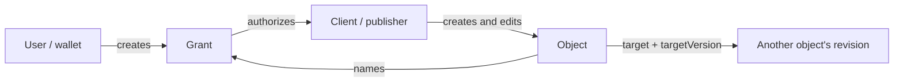

# Memeplex: an open publishing graph (#1436)

Status: design; not implemented. This core defines grants, attribution and
publication state; the [reference](memeplex-reference-1436.md) defines formats and
implementation detail.

**Memeplex lets a person publish through an application without giving it their
identity keys. Every publication has its own identity, history and place in a
shared graph.** Memepool is the first client; any client can publish into the same
graph or build a different view of it.

A grant authorizes a client. A signed history records its work. The last
attributed version is the publication.

## The model

There are two asset shapes and one relationship:

| Element | Meaning |
|---|---|
| **Grant** | A user authorizes one client to publish particular kinds of objects. |
| **Object** | A client publishes a versioned work under that grant. |
| **Target** | An object responds to a particular revision of another object. |



The **author** is the user to whom a publication is attributed. The **publisher**
is the separate agent that signs and controls it. Keeping those roles distinct is
what lets the wallet authorize an application without becoming that application.
A user who publishes through their own software creates a separate client agent
and grants it authority in exactly the same way.

Archon supplies asset identity, signatures, accepted histories, storage references
and chain receipts. Memeplex interprets those histories as publications. It adds
no Gatekeeper authorization rule. Indexers compute the graph; readers choose its
presentation, ranking and moderation.

## A small vocabulary

Every object carries `didDocumentData.memeplex`, including `v: 1`, `kind`,
`author` and `grant`. Five kinds describe what the author is doing:

| Kind | Meaning | Variations |
|---|---|---|
| `post` | Say or share something | A title makes an article; a target makes a boost or quote post. |
| `paper` | Publish scholarly work | Markdown body, authors and abstract; optional PDF and source downloads. |
| `reply` | Answer another object | A verdict makes a review. |
| `rating` | Assess another object | A score on the author's declared scale. |
| `tag` | Describe another object | A word makes a label; an emoji makes a reaction. |

Replies, ratings and tags require `target` and `targetVersion`. Posts may carry
both; papers carry neither. A plain boost is a post with a target and no body.
`kind` determines thread membership, so boosts and reactions need no special
thread mechanism. The graph has no independently maintained thread-root field.

Text is inline or referenced by IPFS CID. The object carries no separate creation
clock: its operation history already supplies one. Long essays and one-line posts
share the same identity, revision and attribution rules.

The [reference](memeplex-reference-1436.md#object-format) defines the complete
fields, schemas, kind semantics and examples. Those definitions are part of the
protocol; they do not create additional attribution paths.

## One grant, one client, one chain

A grant is an ordinary asset created and signed by its user. Its data is the
authorization:

```jsonc
{
  "memeplexGrant": {
    "v": 1,
    "client": "did:cid:…client",
    "actions": ["memeplex:post", "memeplex:reply", "memeplex:tag"],
    "nonce": "Qm9vdHN0cmFwIG5vbmNlMTIz"
  }
}
```

The named client must differ from the user. A grant created by someone else and
later transferred to the user confers no authority. The grant's schema applies;
`nonce` correlates a request and carries no authority.

| Action | Kinds it permits |
|---|---|
| `memeplex:post` | `post`, `paper` |
| `memeplex:reply` | `reply` |
| `memeplex:rate` | `rating` |
| `memeplex:tag` | `tag` |
| An extension's pinned schema DID URL | That extension kind |

`actions` is optional. A grant without it permits every core kind, which is what a
full client such as Memepool asks for; single-purpose clients (a reaction widget, a
posting bot, a labelling service) ask for less, so that a compromised client can do
less under the user's name. Extension kinds are never implied: a grant permits one
only by listing its schema DID URL, because a user cannot have reviewed a kind defined
after the grant. The field exists in v1 even though most grants omit it, because
adding it later would need a new `v` (see the reference's Evolution rule), and
verifiers that predate that `v` could not read restricted grants at all.

A permitted creation includes permission to edit and delete that object while
the grant is live, even if the grant's actions later narrow. There is no separate
edit scope or re-delegation in v1.

A grant may carry `expiresAt`, an ISO 8601 UTC date-time. Authority ends for
operations anchored in a block whose time is at or after `expiresAt`. Expiry is a
rule verifiers apply, not an event on the network: the grant DID is not revoked or
changed, and nothing needs to be published. Its history stays, so everything
anchored before then stays attributed. The user can extend, shorten or remove the
expiry with an update, or revoke the grant earlier. This is unlike Archon's
`validUntil`, which makes a DID ephemeral and lets nodes delete its history; a grant
must not use that.

The grant and its objects are created on the same chain registry and publications
stay there. Only mainnet chain registries are permitted:

| Registry | Chain |
|---|---|
| `BTC:mainnet` | Bitcoin |
| `ZEC:mainnet` | Zcash |
| `ETH:mainnet` | Ethereum |
| `SOL:mainnet-beta` | Solana |

A grant on any other registry is void: testnets (`BTC:signet`, `BTC:testnet4`,
`ZEC:testnet`, `ETH:sepolia`, `SOL:devnet`), whose coins are free and whose chains can
be reset, and `local`, `hyperswarm` and `pin`, which have no chain order. Adding a
registry to this list is a protocol revision; until a verifier adopts it, that
verifier treats grants on the new registry as void. Objects gossip
before anchoring, but attribution waits for chain evidence.

A grant is the user's current instructions to one client, read as of each
operation. The user changes its scope or expiry with an ordinary update, and each
operation is checked against the grant version in force before it, so a change
takes effect from its anchor forward and never reaches back. Only these changes
keep the grant:

- A **scope update** changes nothing but `memeplexGrant.actions` and
  `memeplexGrant.expiresAt`, adding, changing or removing either; its data still
  satisfies the grant schema; it is signed by `U`; and no operation that ends the
  grant comes before it in the grant's history, whether anchored or pending. Once
  the history contains an ending operation, such as a transfer to the client, no
  later update is a scope update, so a new controller cannot widen the grant while
  that transfer waits to be anchored.

Every other operation **ends** the grant at its chain position: a deletion (the
normal way, with `revokeDID`), a change of `client` or of any other data, a transfer
or other controller change, a registry change, or a `validUntil`. The client cannot
change in place, because the objects it published are controlled by it and no other
client could continue them.

### Authority is an interval

For user `U`, a **valid grant** is an asset whose accepted history establishes all
of the following:

1. Its creation data satisfies the grant schema.
2. Its create operation names `U` as controller and is signed by `U`.
3. It was created on a permitted registry `R`, without `validUntil`, and its creation
   has an accepted chain receipt on `R`.
4. Its creation data names a client agent `A` different from `U`.

Read the client from the creation. Read `actions` and `expiresAt` from the
**version in force** at a position `P`: the latest of the creation and the anchored
scope updates whose receipts precede `P`. An unanchored creation leaves the grant's
authority pending. The interval check below determines whether a valid
grant still permits a particular operation; revocation does not invalidate the
grant's earlier authority.

Let `X ≺ Y` mean that receipt `X` on the grant's registry is in a block of lower
height than receipt `Y`. Receipts in the same block are unordered: neither precedes
the other.

Comparing within a block would depend on details that are not stable evidence.
Solana's instruction index is local to its transaction, and Gatekeeper keeps one
receipt per operation, registry and ordinal, without the transaction ID, so which of
two same-ordinal copies in different transactions survives depends on delivery
order. Block height is the same in every copy. This conservative relation is an
attribution rule; it does not replace Gatekeeper's sibling ordering.

A valid grant permits an operation at position `P` exactly when:

```text
grant creation ≺ P
and
P ≺ every anchored operation that ends the grant
and
every anchored scope update ≺ P or P ≺ it
and
time(P) < expiresAt of the version in force at P, if it has one
```

The third condition makes a scope update in the same block as `P` fail closed, as
every same-block comparison does. A pending scope update has no effect until it is
anchored; until then the previous version stays in force.

`time(P)` is the time of the block that anchors `P`, which is the accepted event's
`time` for a chain receipt. It comes from the block header, so the publisher cannot
choose it, and every copy of the receipt carries the same value. Block times can be
slightly out of order (Bitcoin allows about two hours of drift), so near the expiry
an operation in a later block may pass while one in an earlier block fails; the rule
is still deterministic, and expiry is coarse by nature.

With no anchored ending operation, the second condition is vacuously true. An
operation without a receipt from the grant's registry is pending there. Check
**all** grant successors: a pending update must not hide an anchored deletion later
in history.
Same-block comparisons fail closed in both directions.

This is why attribution uses a shared chain. A publisher chooses `proof.created`
and can backdate a new signature; it cannot make a newly anchored operation precede
a revocation in an earlier block. Clocks and cross-chain timestamp comparisons
are unnecessary for delegation.

## One rule for publication

Read an object's accepted history in predecessor order. Attribute its longest
prefix whose versions satisfy the following checks:

| Check | Creation | Each later version |
|---|---|---|
| Shape | Valid kind schema and semantic rules | Same validation; deletion uses its predecessor's identity and needs no data body |
| Author and publisher | Grant creator is `author`; creation controller is the grant's client | Predecessor controller is that same client |
| Scope | The version in force at the creation permits `kind` | Creation's permission continues to cover edits and deletion |
| Identity | Establish `author`, `kind`, `grant`, `target`, controller and registry; no `validUntil` | Updates preserve them and add no `validUntil`; `targetVersion` may change. Deletion takes identity from its predecessor. |
| Position | Receipt is on the grant's registry, inside its authority interval | Same condition |

The grant's client always comes from its creation, and its scope and expiry from the
version in force at each position, including after the grant is deleted.
Object data comes from the version being checked, not the current document.
An asset transfer cannot manufacture authorship: Archon requires the previous
controller's signature, not the recipient's agreement.

A missing anchor leaves that version and its successors pending. A failed check
ends attribution for that version and its successors. Neither case erases the
already-attributed prefix. A creation that fails cannot be repaired into a
publication by a later edit. These decisions are relative to the current accepted
histories and receipts; reconsider them when that evidence changes.

**Publication state is the last version in that attributed prefix.**

| Prefix result | Publication state |
|---|---|
| No attributed creation; creation pending | Pending, never presented as verified authorship |
| No attributed creation; creation fails | No publication |
| Last attributed version is a creation or update | Show and count that version |
| Last attributed version is a deletion | A tombstone; no longer counted |

Apply this same state to timelines, threads, ratings, labels and coauthor
confirmations. An unauthorized deletion, invalid edit or removed `memeplex`
member changes none of them. Clients may expose the later history separately.

For example, if a rating is created at block 20, edited at 30, its grant revoked
at 40, and the client deletes the rating at 50, the publication remains the rating
from block 30. If its deletion was instead attributed at 35, it is withdrawn.
No special rule for ratings or revocation is needed.

### Reading the evidence

Use `exportDIDs` (`POST /api/v1/dids/export`) for accepted events and
`resolveDID` with `versionId` for version-specific data. A version's identity is
the canonical CID of its operation (`opid`, or computed as Gatekeeper computes
it); `previd` links its predecessor. Keep all comparisons on the same accepted
history, and recompute when that history changes.

For creation, the signer is the controller named by the operation; thereafter it
is the predecessor's controller. `proof.verificationMethod` selects a key and may
be relative, so it is not a source of the signer DID. A verifier relying on its
trusted Gatekeeper need not repeat signature verification.

Chain position is the block height of the accepted event's receipt
(`registration.height`) when the event's `registry` is the grant's registry. The
event's `time` is the anchoring block's time; it is the only clock attribution uses,
for `expiresAt`, and is also shown to readers. Publisher-chosen `proof.created` and
Archon's historical resolution by `versionTime` never decide grant validity.
Implement this interpretation once in a library shared by clients and indexers.

## References remember what was read

An object DID names a work. A `versionId` names one revision in its accepted
history. Responses carry the pair `target` and `targetVersion`; inline embeds use
`did:cid:…?versionId=…`. A response continues to mean the revision it assessed
when the target changes. Reviews and ratings prominently identify older revisions.

Sequence numbers and times are not substitutes for content identity. If replay
displaces the cited revision, resolution may return `notFound`; show "revision no
longer in the history", never a different revision. Anchoring gives a version
priority over later-position siblings, but previously withheld evidence of an
earlier anchor can still displace it. Chain reorganizations and authorization
replay also remain Archon's responsibility. Attribution is a view of accepted
evidence, not a promise that evidence can never change.

Content identity does not guarantee availability. A reviewer who needs the
assessed bytes to survive keeps and pins their content CID. The [reference's
content rules](memeplex-reference-1436.md#content-availability) cover this separately
from attribution.

## A graph anyone can reconstruct

An indexer discovers objects from operations in `GET /api/v1/events`, including
objects already deleted or edited out of their original shape. It then derives
publication state from their histories. A fresh rebuild and a continuously
running index must agree on the same evidence.

The feed is ordered by event time, not arrival. Polling alone misses late evidence
and displaced branches, so indexers also reconcile indexed histories and reread
the feed over its full range. Recheck dependent publications when their histories,
grant histories or compared receipts change. Indexer caches confer no authority.

Reconstruction needs the evidence to still exist. Archon lets an asset's controller
set `validUntil` in an update, and nodes then remove the asset's history once it
passes. A publication can never be ephemeral (an attributed version has no
`validUntil`), but a revoked client can still expire the objects it controls, and a
node that removes them can no longer serve their histories. Indexers therefore keep
the exported histories of the objects and grants they index, and keep using them
after nodes drop those DIDs; a publication remains attributed on that retained,
signed evidence. A fresh indexer can rebuild only what some node or archive still
holds.

Gatekeeper's data queries are useful discovery shortcuts. They match current
data, so they cannot find every publication preserved behind an unauthorized edit
or deletion. Complete timelines and threads require historical discovery. Both
paths use the same publication rule; neither trusts an object's claimed `author`.

## What revocation means

Revocation ends future authority and preserves the attributed past. Expiry has the
same effect on attribution without any operation: the grant stays active on Archon,
and verifiers stop admitting operations anchored at or after its `expiresAt`. It needs no
inventory of a client's work and cannot disown a compromised client's publications
that were anchored while its grant was live.

When a grant ends, it **freezes existing objects**: no later edit or deletion of
them is attributed. Renewing, extending or rescoping a grant for the same client is a
scope update, not an ending, so its objects stay editable. Only ending the grant
(revoking it, or changing its client) freezes them. A new grant permits new
publications; republishing does not withdraw an old rating or coauthor confirmation.
Direct user control remains a separate design question, not an exception to the
attribution rule.

To withdraw work first, have the client delete it and confirm that its anchor
precedes revocation under `≺`. Submission order alone is insufficient. If immediate
containment matters more, revoke at once and accept that pending withdrawals may
fail. A user cannot force a compromised client to delete work it controls.

The wallet distinguishes requested, submitted and effective revocation. Authority
ends at the chain position, not at the button press. Pending transactions, funding,
mediator availability and chain inclusion determine the delay; there is no fixed
upper bound. This is the same for every operation on a chain registry: anchoring
is the responsibility of the node the deletion is submitted to and its mediator, and
Memeplex adds no recovery mechanism of its own.

## Security considerations

- **Spoofed authorship:** an object's `author` is a claim until its history passes
  the [publication rule](#one-rule-for-publication).
- **Forged grants:** require the user's signature and control at creation, not a
  later transfer to the user; see [grant validity](#authority-is-an-interval).
- **Backdating:** compare receipts on one chain, not publisher-selected clocks;
  [revocation](#what-revocation-means) remains pending until anchored.
- **Over-broad or forgotten grants:** single-purpose clients request listed
  actions, and the [wallet](memeplex-reference-1436.md#wallet) shows each grant's
  scope and lists grants for revocation.
- **Transferred objects:** ownership cannot confer authorship; the
  [attributed prefix](#one-rule-for-publication) ends at a transfer.
- **Untrusted rendering:** enforce safe formats and resource budgets before
  rendering; see [text formatting](memeplex-reference-1436.md#text-formatting).
- **Spam:** batch anchoring alone is not a rate limit; services and indexers need
  their own [controls](memeplex-reference-1436.md#design-choices).
- **Unavailable content:** operation pinning does not preserve referenced bytes;
  [content availability](memeplex-reference-1436.md#content-availability) needs
  separate pinning.

## Scope and decisions still open

V1 publishes public plaintext. It defines no private circles, public follow graph,
central ranking, mandatory moderation authority or payment rail. Memepool keeps
follows as private reader state, and uses ordinary tags for opt-in moderation.
Clients can differ in their views while agreeing about the underlying publications.

The [companion reference](memeplex-reference-1436.md) contains field-level rules,
examples, rendering requirements, the grant request flow, discovery queries,
Memepool choices and the implementation/benchmark plan. Its rendering budgets
limit automatic presentation; they do not decide authorship.

Before implementation, settle concrete benchmark targets and publish the pinned
schemas and signed verifier fixtures. Narrower scopes, an arrival-ordered change
feed, public follows and long-term content pinning
remain [open questions](memeplex-reference-1436.md#open-questions).
